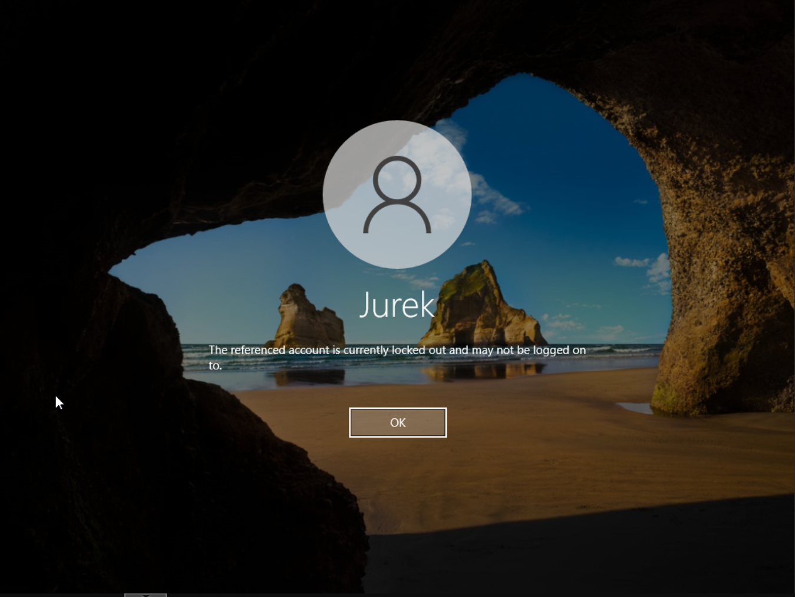
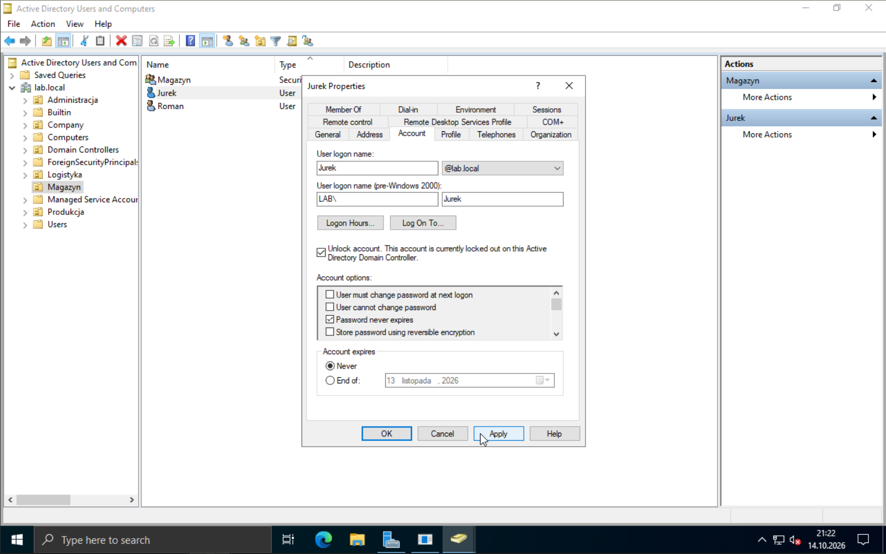

# Odblokowanie konta domenowego — symulacja w homelabie **Rozwiązane**

## Zgłoszenie
Użytkownik zgłosił, że nie może się zalogować do swojego konta domenowego. Po wprowadzeniu hasła otrzymuje komunikat o błędzie logowania.
Użytkownik pamięta hasło ale wpisywał w pośpiechu, dlatego prosi aby nie resetować hasła.

## Diagnoza
Sprawdziłem w Active Directory firmy, że użytkownik jest zablokowany. W homelabie odtworzyłem sytuację i potwierdziłem, że konto jest zablokowane po kilku nieudanych próbach logowania.

## Przyczyna
Zbyt wiele nieudanych prób logowania spowodowało zablokowanie konta użytkownika "Jurek" (Zasady GPO blokują konto po 5 nieudanych próbach logowania w ciągu 10 minut).

## Działanie
Odblokowałem konto użytkownika "Jurek" w Active Directory.

## Weryfikacja
Użytkownik (ja) potwierdził, że może się zalogować do swojego konta domenowego po odblokowaniu.

## Narzędzia
GLPI, Active Directory Users and Computers

## Dowody

