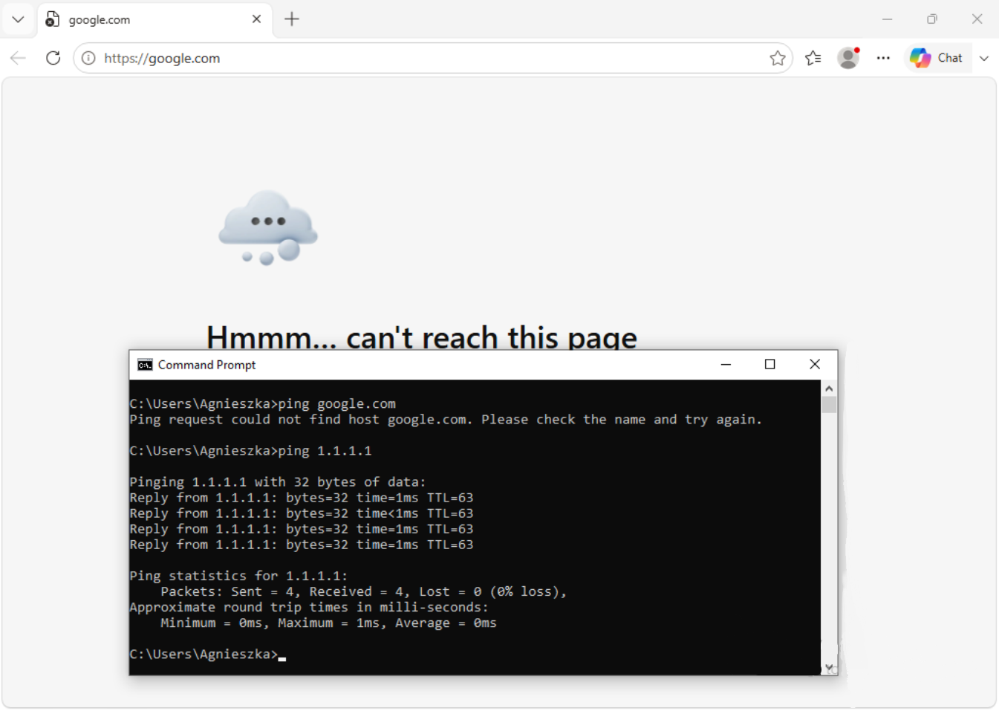
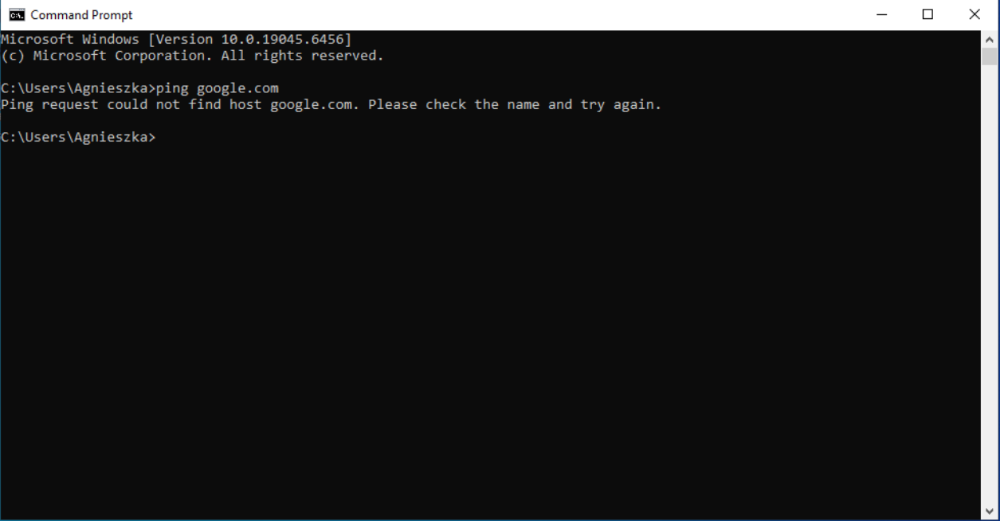
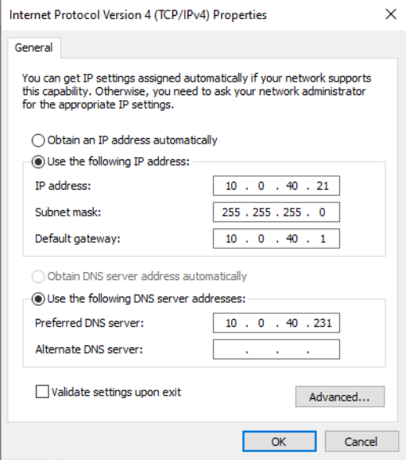
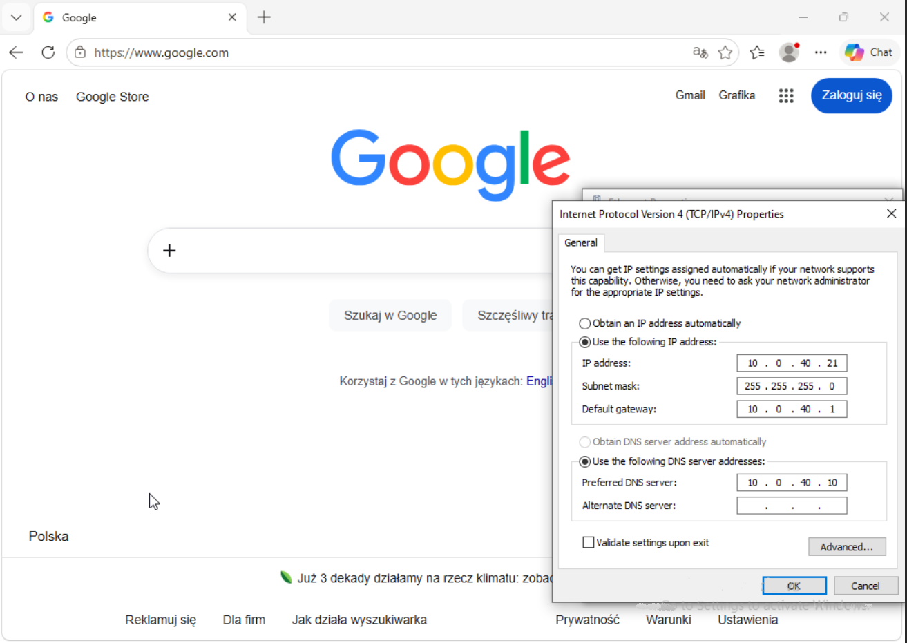
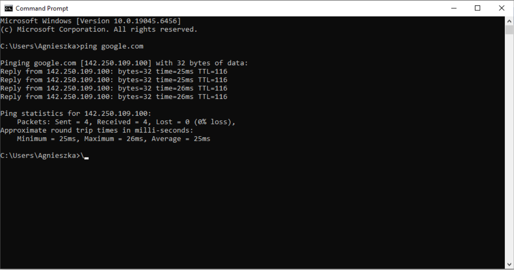

# Brak dostępu do stron internetowych  — symulacja w homelabie **Rozwiązane**

## Zgłoszenie
Użytkowniczka Agnieszka zgłosiła problem z wyświetlaniem stron internetowych. Użytkowniczka  używa przeglądarki Edge, kolega z pracy zasugerował sprawdzenie w wierszu poleceń komendy pingującej widocznej na zdjęciu poniżej.

## Diagnoza
Na zrzutach ekranu widać, że `ping 1.1.1.1` zwracał odpowiedzi, natomiast `ping google.com` nie mógł odnaleźć hosta. Agnieszka potwierdziła, że na innych komputerach strony internetowe działały poprawnie. Poprosiłem ją o przesłanie wyniku `ipconfig /all`. Po sprawdzeniu konfiguracji sieciowej Lenovo zauważyłem, że ustawiony adres serwera DNS różnił się od właściwego adresu serwera obsługującego domenę `lab.local`.

## Przyczyna
Przyczyną problemu jest zła konfiguracja DNS na komputerze użytkowniczki, DNS ustawiony był na adres 10.0.40.231.

## Działanie
Po uzyskaniu zgody połączyłem się przez RDP z komputerem Lenovo.lab.local, a następnie zmieniłem w ustawieniach adres serwera DNS na 10.0.40.10. Następnie sprawdziłem działanie stron internetowych.

## Weryfikacja
Po zmianie DNS sprawdziłem otwieranie stron oraz `ping google.com`. Nazwa została rozpoznana, a polecenie zwróciło odpowiedzi. Agnieszka potwierdziła w zgłoszeniu GLPI, że strony działają.

## Użyte narzędzia
GLPI, ping, RDP, ipconfig /all
