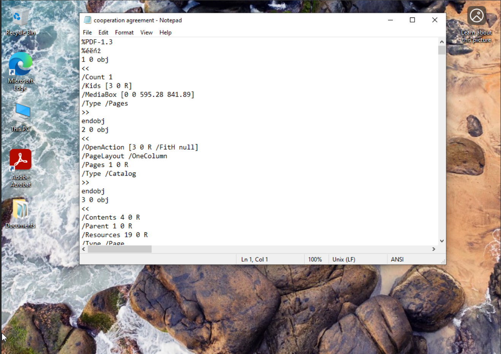
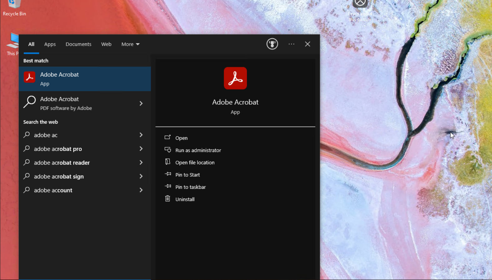
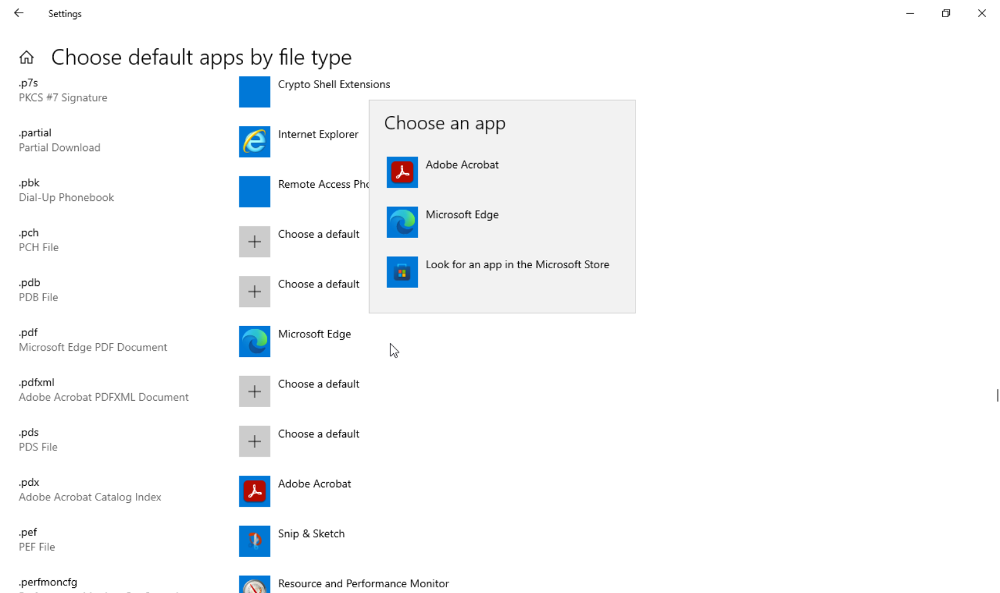
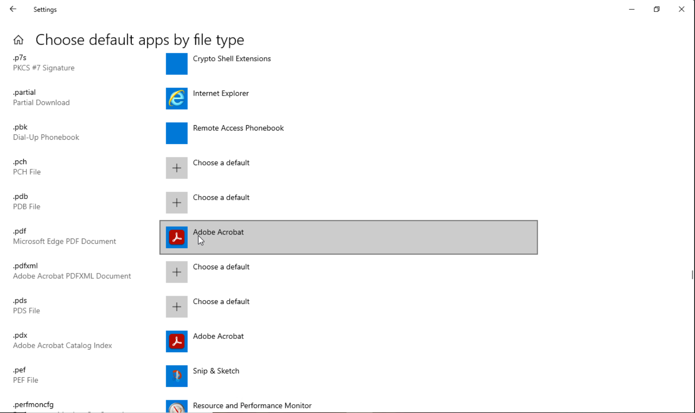
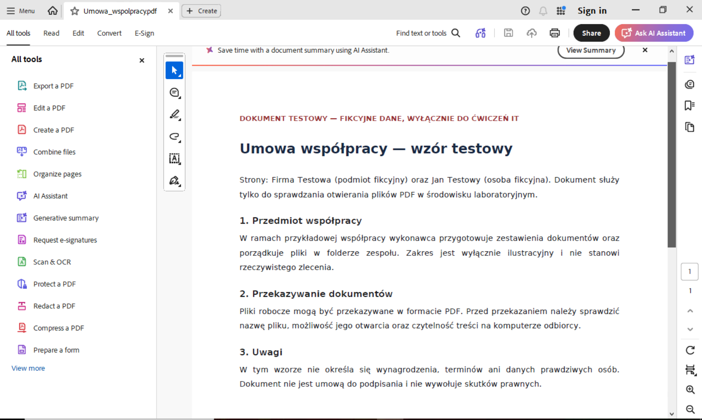

# Pliki PDF otwierają się w Notatniku — symulacja w homelabie **Rozwiązane**

## Zgłoszenie
Użytkownik Marcin zgłosił problem z wyświetlaniem dokumentów z rozszerzeniem pdf. Zamiast w aplikacji Adobe Acrobat Reader dokumenty otwierały się w systemowym Notatniku.

## Diagnoza
Po uzyskaniu nazwy komputera i zgody od użytkownika połączyłem się przez Anydesk z jego aktywną sesją. Sprawdziłem czy Adobe Acrobat Reader jest zainstalowany na komputerze. Następnie w ustawieniach aplikacji domyślnych sprawdziłem rozszerzenie .pdf — przypisaną do niego aplikacją był Notatnik.

## Przyczyna
 Przyczyną było nieprawidłowe skojarzenie rozszerzenia plików .pdf z Notatnikiem zamiast z aplikacją Adobe Acrobat Reader.

## Działanie
 W sesji Marcina, zmieniłem domyślną aplikację dla plików .pdf z Notatnika na Adobe Acrobat Reader.
 
 

## Weryfikacja
Po zmianie otworzyłem dwa testowe pliki, oba uruchomiły się w Adobe Acrobat Reader. Poprosiłem  klienta Marcina o sprawdzenie na swoim koncie czy pliki pdf otwierają się poprawnie. Marcin potwierdził, że problem został rozwiązany.

## Użyte narzędzia
GLPI, Anydesk, Adobe Acrobat Reader.
